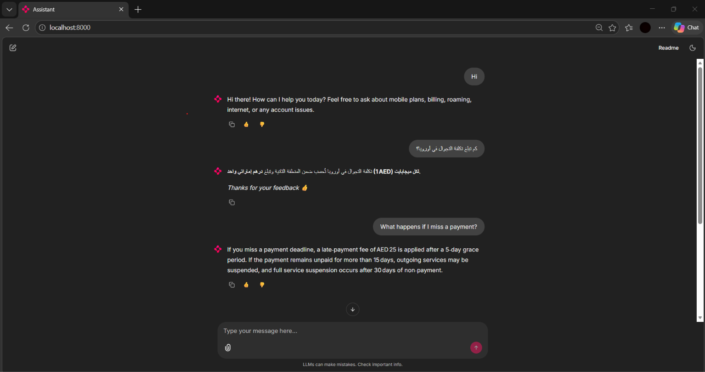

# Arabic/English RAG Customer Support Chatbot

A multilingual retrieval-augmented generation (RAG) chatbot for telecom customer support. It answers questions about mobile plans, billing, roaming, internet and account issues, and replies in the same language the user writes in (English or Arabic). It only answers from a curated knowledge base, which reduces made-up answers.

Built during my AI Engineering internship at e& (Etisalat), June–August 2026.



## Features

- **Bilingual:** detects whether the question is in English or Arabic and answers in that language, even when the retrieved context is in the other language
- **Grounded answers:** responds only from retrieved knowledge base content, and says so when the answer isn't available
- **Intent routing:** an LLM classifier separates casual chat from real product questions, so greetings get a friendly reply instead of a document search
- **Answer rating:** every reply has 👍 / 👎 buttons; each rating is logged to `feedback.csv` with the question, answer, category and timestamp for evaluating answer quality
- **Input guardrails:** blocks empty messages, limits input to 500 characters, and rate-limits each session (5 messages per 30 seconds)
- **Containerised deployment:** Dockerised and deployed on Railway

## Architecture

```
User message
     │
     ▼
Input checks (empty / length / rate limit)
     │
     ▼
Intent classifier (LLM)
     │
     ├── chitchat ──► Friendly reply in the user's language
     │
     └── product ──► Embed query (FastEmbed, multilingual MiniLM)
                          │
                          ▼
                     Retrieve top 5 chunks (ChromaDB)
                          │
                          ▼
                     Generate grounded answer (LLM via Groq)
                          │
                          ▼
                     User rates answer 👍 / 👎 ──► feedback.csv
```

## Tech Stack

| Component | Technology |
|---|---|
| LLM | GPT-OSS 120B via Groq (originally Llama 3.3 70B, migrated after Groq retired it) |
| Orchestration | LangChain |
| Embeddings | FastEmbed – `paraphrase-multilingual-MiniLM-L12-v2` |
| Vector database | ChromaDB |
| Interface | Chainlit |
| Deployment | Docker, Railway |

## Project Structure

```
├── app.py                             # Chainlit app: routing, retrieval, generation and rating
├── fastembed.ipynb                    # Builds the ChromaDB vector store from the knowledge base
├── telecom_faq_knowledge_base.md      # Source knowledge base
├── chroma_db/                         # Prebuilt vector store
├── screenshots/                       # Demo images
├── Dockerfile                         # Container setup
├── requirements.txt
└── RAG_Chatbot_Solution_Document.pdf  # Full solution write-up
```

## Running Locally

1. Clone the repo:
   ```
   git clone https://github.com/uzair852/arabic-english-rag-chatbot.git
   cd arabic-english-rag-chatbot
   ```
2. Install dependencies:
   ```
   pip install -r requirements.txt
   ```
3. Create a `.env` file with your Groq API key:
   ```
   GROQ_API_KEY=your_key_here
   ```
4. Start the app:
   ```
   chainlit run app.py
   ```

The vector store is already included. To rebuild it after changing the knowledge base, run `fastembed.ipynb`. Ratings are saved to `feedback.csv` in the project folder.

## Documentation

See [RAG_Chatbot_Solution_Document.pdf](RAG_Chatbot_Solution_Document.pdf) for the full design and evaluation write-up.